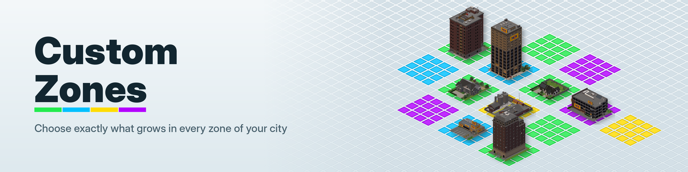
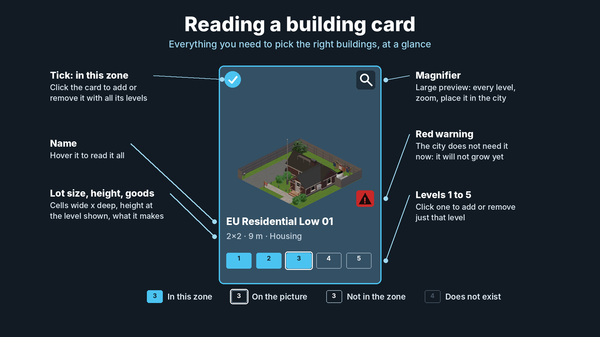
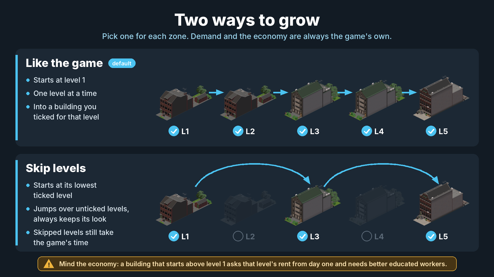
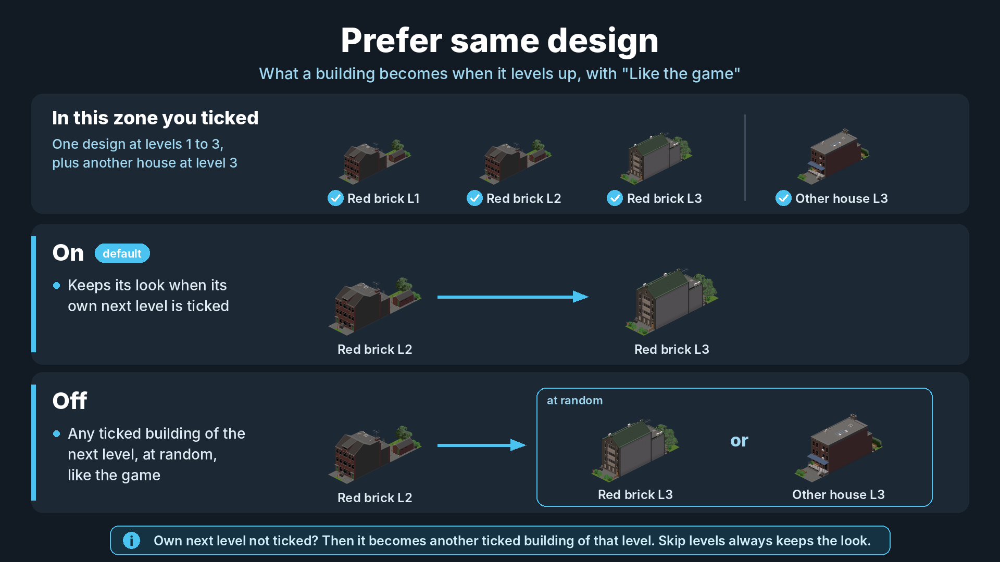
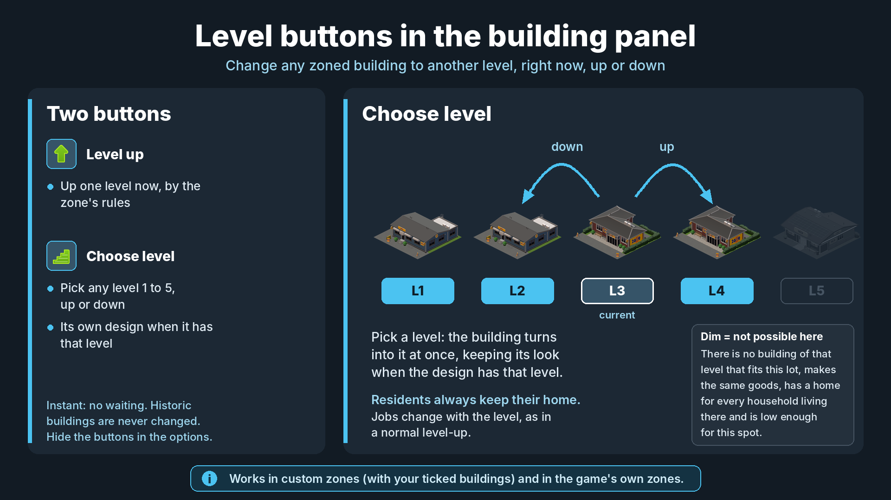

# Custom Zones

A Cities: Skylines II code mod. It lets players create their own zone types and choose exactly which growable buildings may spawn and level up in each of them, while the game's demand, growth and economy rules stay in charge.

> Strongly recommended: [Building Icon Generator](https://github.com/dvovo/BuildingIconGenerator), by the same author, for a real picture of every building in the browser.

- **Status:** beta (`1.0.1-beta`), built against game version 1.6.2f1.
- **Player guide:** [DESCRIPTION.md](DESCRIPTION.md) is the text of the Paradox Mods page and explains every option from the player's side. This README covers how the mod works.
- **Bugs and ideas:** open an issue with the templates of this repository (please attach `CustomZones.log`), or post in the [forum thread](https://forum.paradoxplaza.com/forum/threads/mod-beta-custom-zones-discussion-feedback.1947164/), which is also the discussion of the mod's Paradox Mods page.
- **Images:** the mod icon, thumbnail, banner and social image are in `Branding/`; the gallery is in `CustomZones/Properties/Screenshots/`.

Author: **dvovo** — [Paradox Mods](https://mods.paradoxplaza.com/authors/dvovo) · [Mod page](https://mods.paradoxplaza.com/mods/165018/Windows) · [Source](https://github.com/dvovo/CustomZones) · Developed with the help of AI · License: [MIT](LICENSE)

## At a glance

| | |
| --- | --- |
|  |  |
|  |  |

## Contents

- [Design rules](#design-rules)
- [Project layout](#project-layout)
- [Custom zones as prefabs](#custom-zones-as-prefabs)
- [Building index and families](#building-index-and-families)
- [Spawning](#spawning)
- [Zone check and condemnation](#zone-check-and-condemnation)
- [Levelling up](#levelling-up)
- [UI](#ui)
- [Data files](#data-files)
- [Saved components](#saved-components)
- [Compatibility notes](#compatibility-notes)
- [Building from source](#building-from-source)
- [Logs and bug reports](#logs-and-bug-reports)
- [Credits and license](#credits-and-license)

## Design rules

1. **Demand is read, never written.** The mod never changes the residential, commercial, industrial or office demand, or any economy value.
2. **The game's own jobs do the work.** Spawning, the zone check and level-ups run the game's code paths. The mod only narrows the candidate buildings to the ones a zone allows, and steps aside when something unexpected happens.
3. **The economy follows the prefab.** Rent, upkeep, homes, workplaces, education mix and abandonment all come from the prefab and level the game finally builds. The mod never edits those values; it only chooses which prefab is built.

## Project layout

| Path | Contents |
| --- | --- |
| `CustomZones/Mod.cs` | Entry point: registers systems, update order, settings, locales. |
| `CustomZones/Setting.cs` | Options page (`ModSetting`). |
| `CustomZones/Domain/` | `PaletteDefinition` (a zone), `GrowthMode`, filters, building families and selection keys, UI entry types. |
| `CustomZones/Storage/` | `PaletteStorage` (zone library, export / import) and `IconLibrary` (saved icons). |
| `CustomZones/Prefab/` | `PaletteZonePrefab`, the runtime zone prefab type. |
| `CustomZones/Components/` | `PaletteZoneMarker` and the `PaletteAllowedBuilding` buffer. |
| `CustomZones/Systems/` | All ECS systems (below). |
| `CustomZones/Integration/BigIcons.cs` | Reflection client for Building Icon Generator (no hard reference). |
| `CustomZones/Utilities/` | Zone icon recolouring and the icon designer renderer, UI binding helpers, locale loader. |
| `CustomZones/Locale/*.json` | 12 languages. Missing keys fall back to `en-US`. |
| `CustomZones/UI/` | React / TypeScript UI module (cs2 UI toolchain, webpack). |
| `CustomZones/Properties/` | `PublishConfiguration.xml`, thumbnail and gallery images. |

**Systems and where they run:**

| System | Phase | Role |
| --- | --- | --- |
| `BuildingIndexSystem` | PrefabUpdate | Indexes every spawnable building prefab: zone category, density, level, lot size, height, goods, theme, asset packs. Groups them into families. |
| `PaletteZoneSystem` | PrefabUpdate, before `ZoneSystem` | Creates one zone prefab per custom zone, the toolbar category and icons; fills each zone's allowed-building buffer. |
| `PaletteZoneInitSystem` | PrefabUpdate, after `ZoneSystem` | Completes the zone prefabs' data once the game has initialised its own zones. |
| `PaletteZoneSpawnSystem` | GameSimulation, before `ZoneSpawnSystem` | Replaces the game's zone spawner (the original is disabled). |
| `LevelUpControlSystem` | GameSimulation, before `BuildingConstructionSystem` | Applies each zone's level-up rules; info panel level buttons. |
| `PlacedByHandSystem` | ModificationEnd, before the zone check | Tags growable buildings placed by hand. |
| `CustomZoneCheckSystem` | ModificationEnd | Replaces the game's `ZoneCheckSystem` (the original is disabled). |
| `CustomZoneSaveSystem` | ModificationEnd | Obsolete; kept so cities saved with early test builds still load. |
| `PaletteUISystem` | UIUpdate | Bindings and triggers of the panel, zone window, browser and preview. |
| `IconGeneratorSystem` | UIUpdate | Fallback building pictures when the game and BIG have none. |

## Custom zones as prefabs

- **Each custom zone is a real `ZonePrefab`** (`PaletteZonePrefab`, named `CZ_Zone_<id>`), created with `ScriptableObject.CreateInstance` and added through the prefab system, so it goes through the game's full prefab initialisation. It copies the components of the game zone it is based on (`m_AreaType`, office flag, density), without theme or unlock requirements, and has its own `UIObject` in the `CZ_PaletteCategory` toolbar tab.
- **Timing:** the zones are created in `Mod.OnLoad`, before any city loads, because the zone prefabs must exist when the game maps the saved zone indices of a city. Zones created or deleted mid-game are added to the toolbar with an unlock refresh.
- **Painting** is the game's own zoning tool. The zone colour is set on the prefab; the icon is either a recoloured game icon, a saved icon, or one drawn by the icon designer (`gen:` values rendered to SVG).
- **Allowed buildings:** each zone entity has a `PaletteAllowedBuilding` buffer with the prefabs that may be **born** in it. It is rebuilt whenever the zone library or the building index changes.

## Building index and families

- **Family = one design at one lot size**, for example `EU_ResidentialMediumRow01|1x5`. Prefab names are parsed as `<family>_L<level>[_<W>x<D>]<rest>`; display names are read from the game's localisation.
- **Selection key = family plus level**, `"<family>@<level>"`. A zone stores a set of these keys. Ticking a card adds every level the family has; the level pills toggle single keys.
- **Level kinds** sent to the UI: `2` the family has a prefab at that level, `1` it has none but the game draws it with the level below, `0` nothing.
- **Meshless prefabs** (for example some industrial storage lots that only place trees) are kept: they are valid spawnable buildings in the game.
- **Pictures:** game icon (or Asset Icon Library), then a Building Icon Generator thumbnail, then the internal fallback renderer (grey untextured model), then the zone icon.

## Spawning

`PaletteZoneSpawnSystem` replaces `Game.Simulation.ZoneSpawnSystem`.

- It runs the game's own spawn-area evaluation and building spawn job, with the same demand gates (empty demand bar = nothing of that type grows), the same per-building demand (by density for housing, by goods sold or made for companies) and the same lot scoring (land value, pollution, services, road access).
- **On custom zone cells, the candidate list is the zone's allowed-building buffer** instead of every building of the base zone. Game zones are untouched.
- **Each candidate is scored exactly as the game scores it on its own zone:** density demand, office detection (an industrial zone without process estimates), process estimates, corner and narrow-lot rules all come from the building's own zone prefab, so a custom zone may mix designs of several zones without changing how any of them is judged.
- **Progression is kept:** custom zone prefabs carry no unlock requirement, so buildings whose own zone (or the building itself) is still `Locked` in the city are skipped, as they could not grow in the game before that milestone. The zone window shows how many are waiting.
- **Which buildings are born** (`BuildingFamilies.BornSelections`):
  - `GrowthMode.LikeGame`: the zone's level 1 selections, exactly like the game, whose `EvaluateSpawnAreas` only spawns level 1 buildings.
  - `GrowthMode.SkipLevels`: each family's lowest selected level.
- **Diagnosis:** for each custom zone, the furthest stage a free lot reached in the last pass (no lots, nothing fits, no demand, low score, growing). The zone window shows it as plain text.
- **Safety:** if the spawn pass throws (for example after a game update changed a type it relies on), the system logs the error, re-enables the game's spawner and disables itself. Custom zones then stop growing, but the city keeps working.
- The main-thread cost is measured and logged every 4096 passes.

## Zone check and condemnation

`CustomZoneCheckSystem` is the game's `ZoneCheckSystem` (which condemns a growable building whose zone changed), extended so that a custom zone cell is valid for the buildings in that zone's list.

- Editing a zone's list re-checks the buildings standing on that zone, so a removed design is condemned like a building on the wrong zone.
- **Buildings placed by hand** (the game's placement tool, "place it in the city", Find It and similar) get a `HandPlaced` component with a hash of the zones under their lot. While the hash does not change, the check skips them. When the zone under them changes, the normal rule applies. This can be turned off in the options.
- Deleting a zone from the panel unzones its painted cells first, which condemns its buildings exactly like erasing zoning.

## Levelling up

The game levels a building up in `BuildingUpkeepSystem`: when its condition reaches the levelling cost, it requests construction materials (`ResourceNeeding`); when they arrive, `LevelupJob` picks a random building of the next level with the same zone, lot size, road access, goods, at least as many homes and a height that fits, and the condition goes back to 0. It does not keep the design.

`LevelUpControlSystem` works on top of that, only on custom zones:

- **Material stage.** Every 16 frames it looks at buildings that are gathering materials. If the building cannot level up at all under its zone's rules (level-up off, or no allowed building of the next level), the request is cancelled before anything is bought: condition back to 0 and notification removed, as after a level-up. The game's `GoodsDeliveryDispatchSystem` then drops the pending delivery requests, and a truck already on its way delivers nothing and is not paid (`DeliveryTruckAISystem.DeliverUpkeep` only delivers what a `ResourceNeeding` entry asks for). Buildings that can level up go through the game's material stage unchanged.
- **Swap stage.** When the game has chosen the next prefab, the mod replaces the choice (`UnderConstruction.m_NewPrefab`) with one the zone allows, or cancels the level-up.
- **Candidate rules** (`IsValidNext`), the same as the game's `LevelupJob`: same zone (a custom zone may mix designs of several zones, but a building only levels within its own), same lot size, road access and goods, at least as many homes as the current prefab, and a height that fits the lot's height limit.
- **`LikeGame`:** next level only, among the zone's selections at that level. With "Prefer same design" the family's own next level wins if it is selected; otherwise a random candidate, like the game. No candidate: the building keeps its level.
- **`SkipLevels`:** the family's own next selected level above the current one (`NextOwnLevel`), never another family.

### Fair time for skipped levels

The levelling cost grows by 4 per level (`40 · 4^level` per home for housing, more for companies) and the condition gain per upkeep tick grows by 2 per level (`amount · 2^level`). Level `k` therefore takes a time proportional to `2^k`.

A building of level `c` that skips to level `t` lets the game's level-up come round

```
1 + Σ 2^(k - c)   for k = c+1 .. t-1
```

times at its own level before it changes, which is the time the game would spend on the levels in between. For example, L3 to L5 takes 3 rounds of L3. Every round is a complete game level-up (materials requested, bought and delivered, condition back to 0, no upkeep while waiting); the extra rounds are cancelled at the swap stage, exactly as when the game finds no building to level into, and the zone statistics and level-up icon are taken back. The counter is the saved component `LevelSkipProgress { m_FromLevel, m_TargetLevel, m_Remaining }`.

### Info panel buttons

"Level up" applies the zone's rules (or the game's on a game zone) immediately. "Choose level" lists every level the building can become on its lot, own design first. Both go through the game's own swap (`UnderConstruction` with `m_Progress = 255`, finished by `BuildingConstructionSystem`, the same path as a natural level-up: same entity, renters kept, sub-objects and nets rebuilt) and reset the building's levelling progress.

Side effects are kept consistent with the game:

- **Homes:** going down, the homes rule compares with the households living there instead of the current prefab, so no household loses its home.
- **Jobs:** the education mix of a workplace depends on its level (`EconomyUtils.CalculateNumberOfWorkplaces`), so `WorkProviderSystem` lays off workers whose slot no longer exists, exactly as after a natural level-up. Industry and offices clamp their staff limit to the building every tick; shops do not, so after a downgrade the mod applies the clamp the game uses when a company moves in (`min(max, fitting)`, at least two thirds of `fitting`).
- **Warehouses:** their capacity scales with level; stock above the new limit is exported by `StorageCompanySystem`.
- **Zone statistics** (`ZoneBuiltRequirementSystem`, used for signature building and other unlocks): every change moves the building between levels in the same queue the game uses. A level-up the game had started and the mod cancels is moved back, its level-up icon removed, and a skip that ends above the game's choice is moved on to its real level.

## UI

- React / TypeScript under `CustomZones/UI/src`, bound with `cs2/api` (`bindValue` / `trigger`).
- **Panel:** zone list, import / export, building browser with filters and search. The browser is virtualised: C# sends only the visible rows (`Families`, plus `FamilyCount`, `ScrollIndex`), and the large preview gets its own `PreviewFamily` binding so it stays current when its card is off screen.
- **Zone window:** name, colour, icon chooser and designer, base zone, growth mode, level-up options, coverage warnings (`Coverage`: lot widths with no building, `NoBirth`, `Stops`), statistics (`ZoneStats`, refreshed every 5 s while open).
- **Panel and zoning toolbar stay in step:** a custom zone picked in the zoning toolbar is selected in the panel (`HandleToolSelection`), and a zone clicked in the panel, created or imported is picked in the toolbar (`PickZone` trigger, `PickPaintZone`, once the new zone has its zone type index). It goes through `ToolbarUISystem.SelectAsset(entity, updateTool: true)` (private, by reflection), as a click in the toolbar does: activating the tool directly would paint with the zone but leave the old one highlighted. `ToolSystem.ActivatePrefabTool` is the fallback..
- Vanilla components (checkbox, dropdown, colour field) are imported through the game's module registry (`vanilla.ts`).

## Data files

All under `%USERPROFILE%\AppData\LocalLow\Colossal Order\Cities Skylines II\ModsData\CustomZones`:

| File | Contents |
| --- | --- |
| `palettes.json` | The zone library: a list of `PaletteDefinition` (id, name, category, density, colour, icon, `Families` selection keys, `LevelUp`, `KeepDesign`, `Growth`). Global, shared by every city. |
| `icon-library.json` | Icons saved from the designer. |
| `Exports/*.json` | Exported zones (the same fields without the id). Importing adds them as new zones; a clashing name gets "(imported)" and a used colour is replaced. |
| `GeneratedIcons/` | Pictures drawn by the fallback renderer. |

Enums are stored by name.

## Saved components

Stored in the city save, all versioned `ISerializable`:

- `HandPlaced { m_ZoneHash }`: buildings placed by hand.
- `LevelSkipProgress`: buildings saving up for a skip.
- `CustomZoneSaveTag` / `CustomZoneIndexEntry`: obsolete, read only.

The zone cells themselves are ordinary game zone cells pointing at the custom zone prefabs.

## Compatibility notes

- **Do not combine with mods that replace `ZoneSpawnSystem` or `ZoneCheckSystem`** (other custom zoning mods): only one of them can own those systems.
- **Plop the Growables:** compatible. Its "never condemn" rule takes precedence for buildings placed by hand.
- **Find It and other placement tools:** buildings they place are tagged as placed by hand.
- **Building Icon Generator:** optional, through reflection (`BuildingIconGenerator.Api.BuildingIcons`). Without it, the fallback renderer is used.
- **Removing the mod:** delete the custom zones in each city first (the panel unzones their cells), otherwise the cells point at zone prefabs that no longer exist.

## Building from source

- **Requirements:** Visual Studio 2022, the Cities: Skylines II modding toolchain (installed from the game's options, sets `CSII_TOOLPATH`) and Node.js.
- **Build:** open `CustomZones.sln` and build the `CustomZones` project. The toolchain copies the mod to the local Mods folder. The UI is built by the project; for UI-only work run `npm install` and `npm run build` in `CustomZones/UI`.
- **Publish:** Visual Studio, Publish, with the profiles in `Properties/PublishProfiles`: `PublishNewMod` once, `PublishNewVersion` for each new version (raise `ModVersion` and write the `ChangeLog` first) and `UpdatePublishedConfiguration` to update only the page (text, images, links). The page text comes from `Properties/PublishConfiguration.xml`, which holds a copy of `DESCRIPTION.md`.

## Logs and bug reports

- The mod logs to `Logs/CustomZones.log` next to the game's other logs: zone creation, building wiring (`PopulateAllowedBuffers`), every level-up decision, cancelled material requests, skip rounds and spawn timing.
- UI errors appear in `Logs/UI.log`.
- Please attach `CustomZones.log` to bug reports, with the steps that led to the problem.

## Credits and license

Custom Zones is made by **dvovo** ([Paradox Mods](https://mods.paradoxplaza.com/authors/dvovo)), developed with the help of AI, and released under the [MIT License](LICENSE).

It builds on ideas and code shared by other Cities: Skylines II mods:

- **FindIt-CSII** (T. D. W., yenyang; MIT License): building classification, browser filters, UI build setup (`webpack.config.js`, `tools/css-presence.js`) and the UI binding helpers.
- **CS2-Platter** (Luca Rager; MIT License): `GenericUIReader`, `GenericUIWriter` and the binding helpers in `ExtendedUISystemBase.cs`, adapted. Their files keep the original author's notice.
- **ZoningByLaw** (FutureProg): the idea of custom zones as zone prefabs and of spawning from a list of allowed buildings, reimplemented.
- **Asset Icon Library**: the `coui://` host and file naming convention followed by the fallback building pictures.

Cities: Skylines II is a trademark of Paradox Interactive. This mod is not affiliated with or endorsed by Paradox Interactive or Colossal Order.
